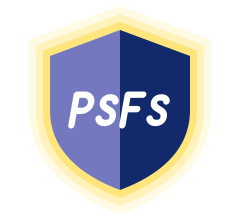

<p align="center">
  
</p>

<h1 align="center">Php Simple Fast and Secure</h1>
<h2 align="center">PSFS Core</h2>

[](https://scrutinizer-ci.com/g/psfs/core/build-status/master)
[](https://github.com/psfs/core/actions/workflows/security-pipeline.yml)
[](https://scrutinizer-ci.com/g/psfs/core/?branch=master)
[](https://scrutinizer-ci.com/g/psfs/core/?branch=master)
[](https://packagist.org/packages/psfs/core)
[](https://php.net/)
[](https://packagist.org/packages/psfs/core)

PSFS is a lightweight PHP framework for MVC/API applications (Twig + Propel + Symfony components).

## 5-minute setup

Prerequisites:

- Docker + Docker Compose
- Git

The validation baseline is PHP 8.3. Compose defaults to PHP 8.5, so select the baseline explicitly with `PHP_VERSION=8.3 docker compose up -d` when validating changes (see [PHP compatibility](./docs/php-compatibility.md)).

<!-- validated -->
```bash
docker compose up -d
docker compose ps
docker exec psfs-php-1 php -v
docker exec psfs-php-1 composer install --no-interaction --prefer-dist
```

If your PHP container name is not `psfs-php-1`:

<!-- validated -->
```bash
docker compose ps
docker ps --format '{{.Names}}'
```

## Daily command map

<!-- example-only -->
```bash
# Run key tests
docker exec psfs-php-1 php vendor/bin/phpunit --no-coverage --filter '/(AuthApiTest|RequestResponseSecurityContractTest)/'

# List PSFS CLI commands
docker exec psfs-php-1 php src/bin/psfs list

# Security local pre-check (act)
act push --container-architecture linux/amd64
```

## Choose your path

### Onboarding path

1. Read [Operations Playbook](./docs/operations.md)
2. Read [DTO Validation Engine](./docs/dto-validation.md)
3. Execute the "First day" flow
4. Use troubleshooting matrix when blocked

### Core contributor path

1. Read [Operations Playbook](./docs/operations.md)
2. Read [DTO Validation Engine](./docs/dto-validation.md)
3. Read [Propel Workflow](./docs/propel-workflow.md)
4. Run key tests and validate changes in Docker

## Propel models and migrations

For operational Propel flow (schema, model generation context, migration execution, rollback, failure modes), see:

- [Propel Workflow](./docs/propel-workflow.md)

## Documentation index

Full documentation site: [docs/README.md](./docs/README.md).

- [Operations Playbook](./docs/operations.md)
- [DTO Validation Engine](./docs/dto-validation.md)
- [Propel Workflow](./docs/propel-workflow.md)
- [PHP compatibility](./docs/php-compatibility.md)
- [Security overview](./docs/security/README.md)
- [Security policy](./SECURITY.md)
- [Admin UI](./docs/admin-ui/README.md)

## Rules

- Run project commands inside Docker containers.
- Keep command blocks explicitly tagged as `validated` or `example-only`.
